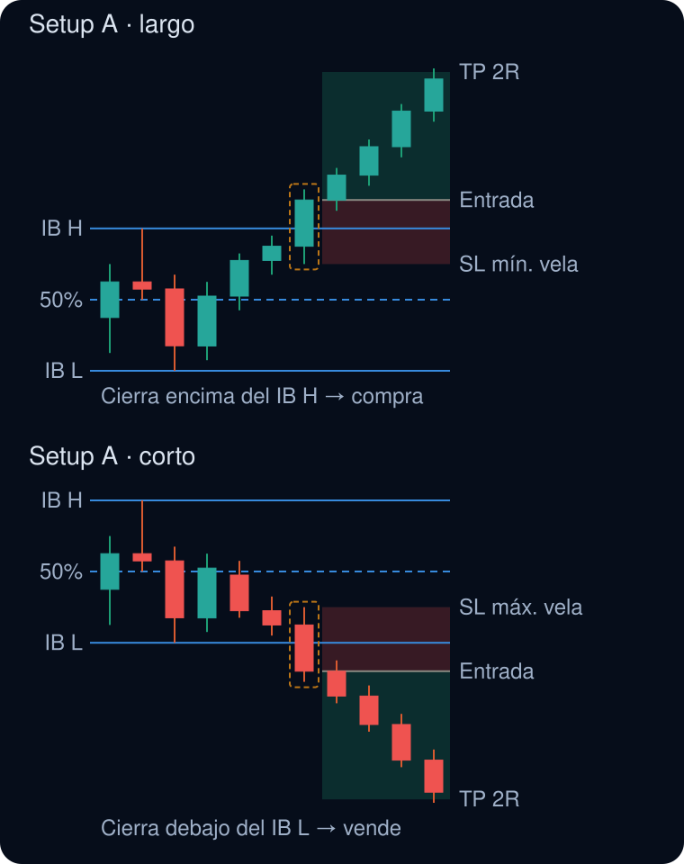
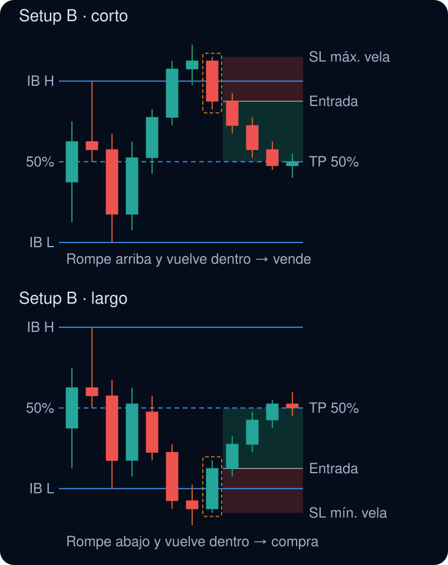
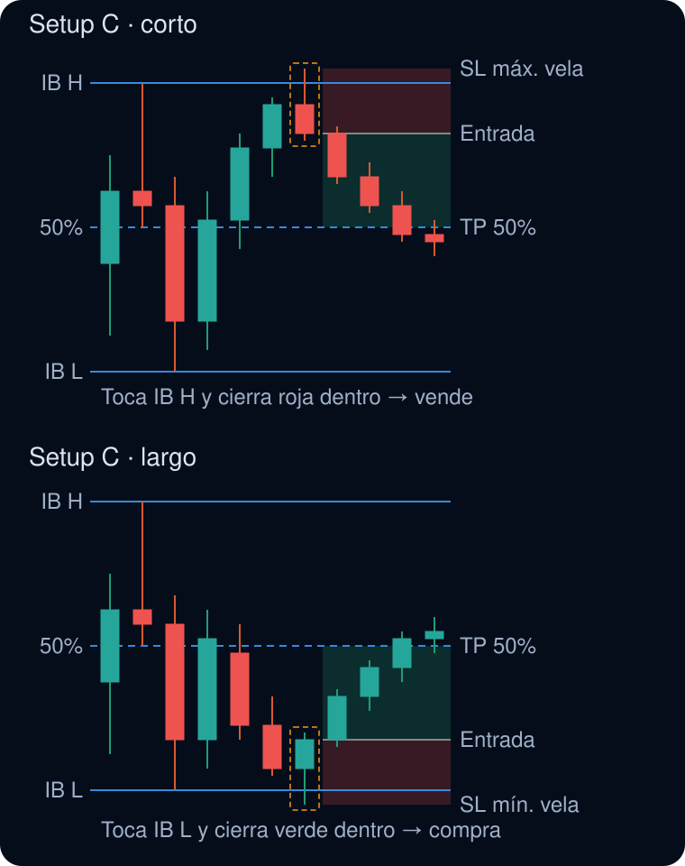
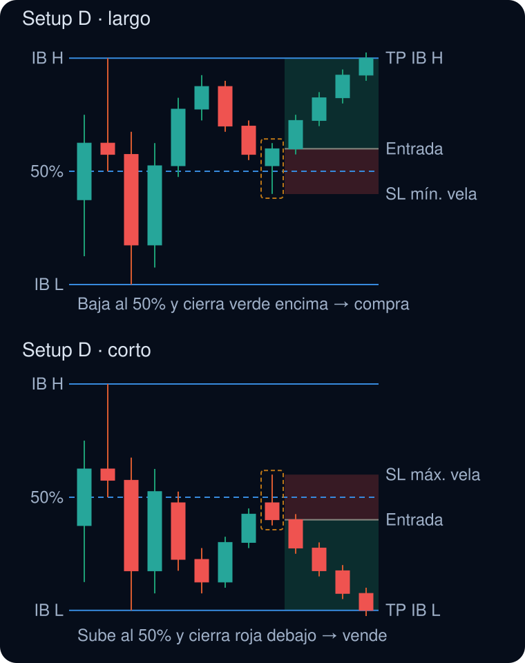

# Scanner IB · Instrucciones de instalación

App de la estrategia de ruptura de la primera hora (IB) para DAX, Nasdaq 100, Dow Jones y S&P 500 en velas de 5 minutos. GitHub Actions descarga los datos cada 5 minutos, calcula las señales y avisa por Telegram. La web en GitHub Pages muestra el gráfico interactivo, las operaciones y el backtest.

## Archivos

| Archivo | Ruta en el repositorio | Para qué sirve |
|---|---|---|
| `index.html` | raíz | La web: gráfico, posiciones editables, estadísticas |
| `scanner_ib.py` | raíz | Descarga datos, calcula señales, envía Telegram |
| `scanner_ib.yml` | `.github/workflows/scanner_ib.yml` | Programa la ejecución cada 5 minutos |
| `sw.js` | raíz | Guarda la web y los últimos datos en el iPad para usarla sin conexión |
| `manifest.json` | raíz | Permite instalarla como app en la pantalla de inicio |
| `esquema_setup_a.svg` … `esquema_setup_d.svg` | raíz | Dibujos de las reglas que aparecen en este documento |
| `INSTRUCCIONES.md` | raíz (opcional) | Este documento |

`data.json` y `state.json` los crea el propio workflow la primera vez. No los subas.

## Paso 1 · Crear el repositorio

1. Entra en github.com con tu usuario `ajb8923`.
2. Pulsa **+** → **New repository**.
3. Nombre: `ScannerIB`. Marca **Public**. Marca **Add a README file**.
4. Pulsa **Create repository**.

## Paso 2 · Subir los archivos de la raíz

1. Dentro del repositorio, pulsa **Add file** → **Upload files**.
2. Selecciona `index.html`, `scanner_ib.py`, `sw.js` y `manifest.json` desde la app Archivos del iPad.
   Antes de confirmar, comprueba que los nombres son exactamente esos, sin espacios ni «(1)».
3. Pulsa **Commit changes**.

## Paso 3 · Crear el workflow

Subiendo archivos desde el iPad no se conservan las carpetas, así que este archivo se crea a mano:

1. Pulsa **Add file** → **Create new file**.
2. En el nombre escribe exactamente: `.github/workflows/scanner_ib.yml`
   Al escribir cada `/` GitHub crea la carpeta automáticamente.
3. Abre `scanner_ib.yml` en el iPad, copia todo su contenido y pégalo.
4. Pulsa **Commit changes**.

## Paso 4 · Secretos de Telegram

Los secretos son por repositorio, así que hay que añadirlos también en este, aunque sea el mismo bot de tus otros scanners.

1. **Settings** → **Secrets and variables** → **Actions** → **New repository secret**.
2. Nombre `TELEGRAM_TOKEN`, valor: el token de tu bot.
3. Otro secreto: nombre `TELEGRAM_CHAT_ID`, valor: tu chat ID.

Si en tus otros repositorios usaste otros nombres, puedes usar esos y cambiarlos en las dos líneas `secrets.` del `.yml`.

## Paso 5 · Permisos de escritura de Actions

1. **Settings** → **Actions** → **General**.
2. En **Workflow permissions**, marca **Read and write permissions**.
3. Pulsa **Save**.

## Paso 6 · Primera ejecución

1. Pestaña **Actions**. Si aparece un aviso para activar los workflows, acéptalo.
2. A la izquierda, **Scanner IB** → **Run workflow** → **Run workflow**.
3. Espera 1 o 2 minutos hasta que salga el tic verde.
4. Vuelve a **Code**: deben haber aparecido `data.json` y `state.json`.

## Paso 7 · Activar GitHub Pages

1. **Settings** → **Pages**.
2. **Source**: Deploy from a branch. **Branch**: `main`, carpeta `/ (root)`. **Save**.
3. Tras 1 o 2 minutos la web estará en: `https://ajb8923.github.io/ScannerIB/`
4. En Safari: Compartir → **Añadir a pantalla de inicio**, para abrirla como una app.

## Avisos puntuales con cron-job.org

El cron de GitHub se retrasa a menudo. Para que las alertas lleguen a tiempo, cron-job.org lanza el workflow cada 5 minutos a través de la API de GitHub. El cron de GitHub queda como respaldo cada 15 minutos, y las señales con más de 15 minutos no se envían (`MAX_AGE` en `scanner_ib.py`).

Configuración: token de GitHub (fine-grained, solo el repositorio ScannerIB, permiso Actions: Read and write) y una tarea en cron-job.org con:
- URL: `https://api.github.com/repos/ajb8923/ScannerIB/actions/workflows/scanner_ib.yml/dispatches`
- Método: POST · Cuerpo: `{"ref":"main"}`
- Cabeceras: `Authorization: Bearer TU_TOKEN`, `Accept: application/vnd.github+json`, `X-GitHub-Api-Version: 2022-11-28`
- Horario: minutos 1, 6, 11 … 56; horas 8–21; lunes a viernes; zona Europe/London
- Respuesta correcta: 204

## Uso sin conexión (en vuelo)

La app guarda en el iPad la página, la librería del gráfico y los últimos datos descargados. Sin conexión puedes revisar el backtest, mover TP y SL y ver estadísticas con los datos de la última vez que tuviste red. No hay datos nuevos hasta que vuelvas a conectarte; las alertas siguen llegando por Telegram cuando recuperas cobertura.

1. Con conexión, abre la web en Safari y añádela a la pantalla de inicio (Compartir → **Añadir a pantalla de inicio**).
2. Abre la app **desde el icono de la pantalla de inicio** una vez con conexión y espera a que cargue el gráfico. Así queda guardada.
3. Antes de cada vuelo, ábrela otra vez con conexión para que guarde los datos más recientes.
4. Para comprobarlo, activa el modo avión y ábrela: arriba verás «Sin conexión · datos de…» con la fecha de los datos.

Importante: en iPad, la app de la pantalla de inicio y Safari guardan los ajustes de TP y SL por separado. Usa siempre la app del icono. Si ya tenías ajustes en Safari, pulsa **Exportar** allí e **Importar** en la app.

## Uso diario

- Durante la sesión, el workflow corre cada 5 minutos de lunes a viernes (07:00 a 21:59 UTC) y la web se recarga sola cada 2 minutos.
- Las alertas de Telegram usan las reglas fijas de `CFG` en `scanner_ib.py`: R:R 2, margen de apertura del setup A de 5 puntos, filtro de noticias 2,5 × ATR, setups A, B, C y D, largos y cortos. Para cambiarlas, edita esa línea en GitHub.
- Los interruptores de la web solo afectan al backtest y al gráfico, no a Telegram.

### Editar posiciones en el gráfico

1. Toca dentro de una posición (zona verde o roja) para seleccionarla.
2. Arrastra el tirador cuadrado del objetivo o del stop. Las etiquetas muestran precio, puntos y R en directo.
3. Al soltar se vuelve a simular la operación con tus niveles y se guarda. También puedes escribir los precios en el panel bajo el gráfico.
4. **Restaurar original** devuelve la operación a la regla fija.
5. El interruptor **Ajustes manuales** activa o desactiva todos tus cambios para comparar estadísticas.
6. Los ajustes se guardan en el navegador del iPad. Usa **Exportar** de vez en cuando como copia de seguridad, e **Importar** para recuperarlos.

## Reglas implementadas

**Rango inicial (IB):** máximo, mínimo y 50% de la primera hora de sesión en velas de 5 minutos (DAX 08:00–09:00, EE. UU. 14:30–15:30, hora de Londres). Antes de que termine la primera hora no se opera.

En los esquemas, la vela con borde ámbar discontinuo es la vela de señal. La entrada es siempre la apertura de la vela siguiente. La zona verde llega hasta el objetivo (TP) y la roja hasta el stop (SL).

### Setup A · ruptura

- **Largo:** una vela cierra por encima del máximo del IB. Entrada en la apertura de la vela siguiente, stop en el mínimo de la vela de ruptura y objetivo a 2R (la entrada más dos veces la distancia entre la entrada y el stop).
- **Corto:** una vela cierra por debajo del mínimo del IB. Entrada en la apertura de la siguiente, stop en el máximo de la vela de ruptura y objetivo a 2R hacia abajo.
- La ruptura cuenta por cierre, no por mecha, y tiene que ser un cruce nuevo: la vela anterior debe haber cerrado dentro del rango.
- El stop va justo en el mínimo o máximo de la vela, sin margen extra. El 2R se mide desde la entrada real.
- **Margen de apertura:** la vela siguiente a la ruptura tiene que abrir al menos 5 puntos por encima del IB H (largos) o por debajo del IB L (cortos). Si abre más cerca, no se opera. Se cambia con `gap` en `CFG` y con la casilla «Margen A (pts)» de la web.

### Setup B · fallo de ruptura al 50%

- **Corto:** el precio ha cerrado por encima del máximo del IB y después una vela vuelve a cerrar dentro del rango. Entrada en la apertura de la siguiente, stop en el máximo de la vela de señal y objetivo en el 50% del IB.
- **Largo:** el precio ha cerrado por debajo del mínimo del IB y después una vela vuelve a cerrar dentro. Entrada en la apertura de la siguiente, stop en el mínimo de la vela de señal y objetivo en el 50%.
- El objetivo no es un 2R fijo, así que el ratio cambia en cada operación según lo lejos que quede el 50%. Si al entrar el precio ya ha pasado el 50%, no se abre la operación.

### Setup C · rechazo del extremo al 50%

- **Corto:** con el IB ya cerrado, una vela llega al máximo del IB (su máximo toca o supera el IB H, sin margen), cierra por debajo del IB H y es roja. Entrada en la apertura de la vela siguiente, stop en el máximo de la vela de señal y objetivo en el 50% del IB.
- **Largo:** una vela llega al mínimo del IB, cierra por encima del IB L y es verde. Entrada en la apertura de la siguiente, stop en el mínimo de la vela de señal y objetivo en el 50%.
- Se diferencia del setup B en que el precio no llega a cerrar fuera del IB: toca el extremo y lo rechaza. Si ya había cerrado fuera antes, la señal cuenta como setup B.
- Como en el B, el ratio depende de la distancia al 50%, y no se abre la operación si al entrar el precio ya ha pasado el 50%.

### Setup D · rebote en el 50% hacia el extremo

- **Largo:** con el IB ya cerrado, el precio viene de la mitad alta (alguna de las 6 velas anteriores cerró por encima del 50%). Una vela llega al 50% (su mínimo lo toca o lo perfora) y cierra verde por encima. Entrada en la apertura de la siguiente, stop en el mínimo de la vela de señal y objetivo en el IB H.
- **Corto:** el precio viene de la mitad baja (alguna de las 6 velas anteriores cerró por debajo del 50%). Una vela llega al 50% y cierra roja por debajo. Entrada en la apertura de la siguiente, stop en el máximo de la vela de señal y objetivo en el IB L.
- Es el reflejo del setup C: allí el rechazo es en el extremo y se va al 50%; aquí el rebote es en el 50% y se va al extremo contrario.
- Una vela que viene de la otra mitad y simplemente cruza el 50% no cuenta: eso es continuación, no rebote. El número de velas hacia atrás se cambia con `d_look` en `CFG`.

### Reglas comunes

- **Filtro de noticias:** no cuenta como señal una vela con un rango mayor que 2,5 veces el ATR(14).
- Solo una operación abierta a la vez. Puede haber varias señales en el mismo día.
- Si una vela cumple varios setups a la vez, cuenta el primero en este orden: A, B, C, D.
- Si una misma vela toca el stop y el objetivo, cuenta como stop.
- Si al final de la sesión no ha tocado ninguno de los dos, se cierra a mercado.
- En la web, el R:R del setup A, el filtro y la duración del IB se pueden cambiar para el backtest. Las alertas de Telegram usan siempre los valores de `CFG` en `scanner_ib.py`.

## Problemas habituales

- **La web dice que no puede cargar `data.json`**: falta el paso 6, o el workflow falló. Mira el error en Actions.
- **El workflow falla en «Guardar datos» con error 403**: falta el paso 5.
- **No llegan mensajes de Telegram**: revisa los nombres de los secretos y que hayas escrito alguna vez al bot. Solo se avisa de señales del día en curso.
- **Los avisos llegan con retraso**: GitHub a veces retrasa varios minutos las ejecuciones programadas. Es normal en el plan gratuito.
- **Los niveles no coinciden con Trade Nation**: Yahoo da el índice de contado, no el CFD. Puede haber unos puntos de diferencia.
- **El VWAP del DAX aparece como «sin volumen»**: Yahoo no suele dar volumen intradía del `^GDAXI`, así que la línea se calcula como media del precio típico de la sesión.
- **Solo hay 60 días de historial**: es el límite de Yahoo para velas de 5 minutos.
